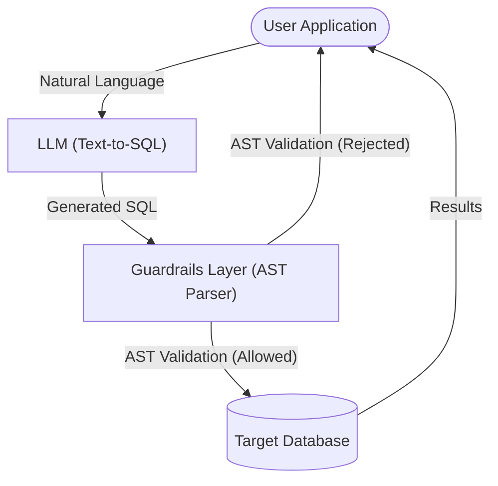
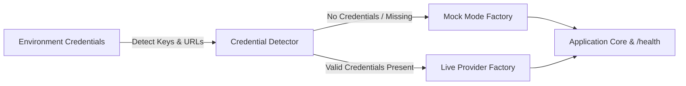
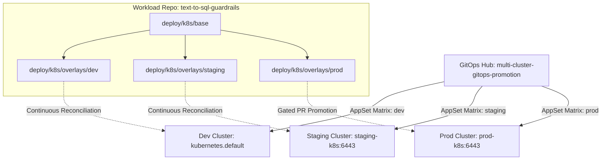

# Architecture — text-to-sql-guardrails
> Last updated: 2026-08-29 | Maturity: Full Prototype
> _Validation layer intercepting LLM-generated SQL._

## System Diagram
The following Mermaid.js sequence diagram maps the core workflow and interactions:

## Component Table

| Component | File | Responsibility | Tech |
|---|---|---|---|
| Validator | `src/validator.py` | Core engine checking AST structures | Python |
| Dialect Checks | `src/dialects.py` | Ensures query matches Postgres/MySQL | Python |

## Dependency Honesty Table

| Dependency | Status | Notes |
|---|---|---|
| SQLGlot (AST) | **Real** | Performs actual deep parsing of queries. |
| LLM | **Simulated** | E2E tests feed hardcoded bad queries instead of calling an LLM. |
| Target DB | **Simulated** | We only validate the query, we don't execute it. |

## Component Breakdown
- **Core Technology**: Python, SQLAlchemy, PostgreSQL
- **Design Paradigm**: Emphasizes high availability, fault tolerance, and security.

## Progressive Credential Loading & Production Architecture (v0.2.0)

This service implements the **Progressive Credential Loading (PCL)** pattern, decoupling development speed from external infrastructure provisioning:

### Core Architecture Components
1. **Mode Detection Singleton:** Inspects environment configuration at boot time without hard crashes on missing secrets.
2. **Dual-Mode Factory Wrappers:**
   - **Storage / Cache:** In-process maps or SQLite `:memory:` transparently promote to managed Redis or PostgreSQL when connection strings are supplied.
   - **AI Providers:** Deterministic heuristic generators and local embeddings transparently promote to live OpenAI, Anthropic, or Gemini API clients.
3. **Hot-Reload & Dynamic TLS:** File watchers monitor mounted volume paths (Kubernetes ConfigMaps and Secrets) to update certificates and limit configs atomically without process restarts.
4. **Health & Observability:** The `/health` endpoint exposes real-time runtime mode metadata (`mock` vs `live`) across all backing adapters.

## Declarative GitOps & Multi-Cluster Deployment Architecture (v0.2.1)

This service participates in the portfolio-wide **ArgoCD Hub-and-Spoke GitOps continuous delivery catalog**:

### GitOps Topology & Separation of Concerns
1. **Base Manifests (`deploy/k8s/base`):** Declares non-root PodSecurity standards (`runAsUser: 10001`, `drop: [ALL]`, `readOnlyRootFilesystem: true`), readiness/liveness HTTP probes, and CPU/memory requests and limits without hardcoding namespace.
2. **Environment Overlays (`deploy/k8s/overlays/`):**
   - `dev/`: 1 replica, `300m/256Mi` limit, automated drift self-healing.
   - `staging/`: 2 replicas, `500m/512Mi` limit, automated drift self-healing.
   - `prod/`: 3 replicas, `1000m/1Gi` limit, gated pull-request review.
3. **ArgoCD Declarations (`deploy/argocd/`):** Houses standalone `Application` CRDs (`application.yaml`, `application-dev.yaml`, `application-prod.yaml`) and values overrides for OCI Helm and Kustomize reconciliation.
